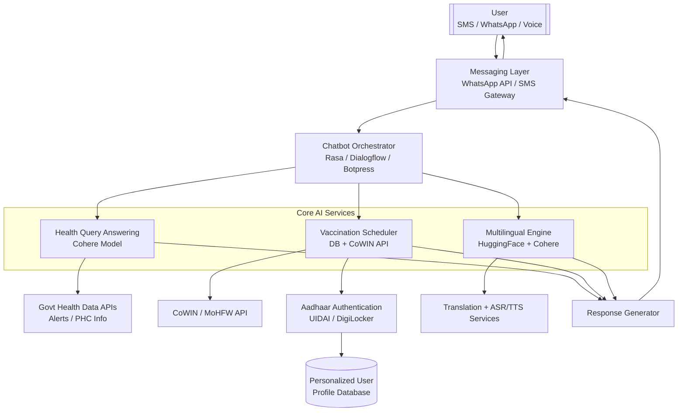

# 🩺 AI-Driven Public Health Chatbot (WhatsApp / SMS)

## 📌 Problem Statement
**Problem ID:** 25049  
**Title:** AI-Driven Public Health Chatbot for Disease Awareness  
**Organization:** Government of Odisha – Electronics & IT Department  
**Theme:** MedTech / BioTech / HealthTech  

Creating a multilingual AI chatbot to educate rural and semi-urban populations about preventive healthcare, disease symptoms, and vaccination schedules. The chatbot should integrate with government health databases and provide real-time alerts for outbreaks.  

---

## 🎯 Project Goal
To Build a multilingual (Odia / Hindi / English) AI chatbot accessible via **WhatsApp and SMS** to educate rural and semi-urban communities about preventive healthcare, symptoms, vaccination schedules, and provide real-time outbreak alerts integrated with government health data.  
**Target:** ≥80% answer accuracy & ≥20% increase in awareness in target communities.  

---

## 🏗️ High-Level Architecture
1. **Frontend Channels**  
   - WhatsApp (via Twilio/Facebook Business API)  
   - SMS gateway (Twilio, Msg91, or local telecom APIs)  

2. **Gateway Adapter**  
   - Handles delivery, message forwarding  

3. **Chatbot Engine**  
   - Rasa / Dialogflow for NLU + dialogue policies  

4. **Knowledge Layer**  
   - FAQ + RAG (vector DB: FAISS/Milvus/Pinecone)  

5. **Backend Services**  
   - Vaccination lookup, symptom triage, outbreak alerts  

6. **Data Store**  
   - Conversation logs, user profiles, analytics  

7. **Admin Dashboard**  
   - Broadcast alerts, manage FAQs, view metrics  

8. **Monitoring**  
   - Grafana, Kibana, Prometheus  

9. **Deployment**  
   - Cloud (AWS / GCP / Azure)  

---

## 🔧 Recommended Tech Stack
- **Chatbot Framework**: Rasa (open source)  
- **Backend**: Python (FastAPI / Flask)  
- **Embeddings**: OpenAI / HuggingFace  
- **Vector DB**: FAISS / Pinecone / Milvus  
- **Database**: PostgreSQL + S3  
- **Frontend**: React (dashboard)  
- **Deployment**: Docker + Kubernetes / Cloud Run  
- **Channels**: Twilio WhatsApp + Msg91 SMS  
- **Monitoring**: Grafana, Prometheus  

---

## 🌐 Multilingual Strategy
- Language detection (fastText/langdetect)  
- Curated FAQs in **Odia, Hindi, English**  
- Human validation for translations  
- Short SMS responses vs. rich WhatsApp messages  

---

## 📊 Data Sources
- Government health portals (MoHFW, State sites)  
- WHO/UNICEF materials  
- District health circulars (outbreak alerts)  
- Vaccination schedule datasets (ICDS, MoHFW)  
- Annotated Q&A pairs in Odia, Hindi, English  

---

## 🔑 Intents & Entities
**Intents**  
- `ask_symptoms`  
- `ask_prevention`  
- `vaccination_schedule`  
- `nearest_health_facility`  
- `report_case`  
- `ask_outbreak_alerts`  
- `greet`, `goodbye`, `thanks`, `request_human`  

**Entities**  
- `disease`, `symptom`, `vaccine`, `age`, `location`, `date`  

---

## 💬 Example Dialogues
**WhatsApp (Odia)**  
User: "ମୋତେ ଜ୍ୱର ଓ ଖୋଜ ବର୍ଣ୍ଣନା କର।"  
Bot: "ଜ୍ୱର > 38°C, ଶରୀର ଯନ୍ତ୍ରଣା, ଖୋଜ = ପାର୍ଦ୍ଧକାର। ନିକଟତମ ସ୍ୱାସ୍ଥ୍ୟ କେନ୍ଦ୍ର ପଚାରନ୍ତୁ।"  

**SMS (English)**  
User: "vaccine for 12 year"  
Bot: "Hi! For 12-year-olds, the recommended vaccine is XYZ on dd-mm-yyyy. Reply 'DETAILS' for more."  

---

## 📈 Evaluation & Metrics
- **Intent classification** → Accuracy, F1  
- **Entity extraction** → Precision/Recall  
- **Response correctness** → Human evaluation  
- **User satisfaction** → Feedback ratings  
- **Awareness uplift** → Pre/post surveys (20% increase target)  

---

## 🔔 Real-time Outbreak Alerts
- Integrate govt APIs / RSS feeds  
- Map alerts to region & deliver via SMS/WhatsApp  
- Admin approval before broadcast  
- Geo-targeted delivery  

---

## 🔒 Privacy & Compliance
- Opt-in consent for users  
- PII anonymization in logs  
- Data encryption (AES-256, TLS)  
- Compliance with Indian IT & health data rules  

---

## 📊 Admin Dashboard Features
- Approve/schedule outbreak broadcasts  
- Manage FAQs & responses  
- View metrics & analytics  
- Escalation tracking to health workers  

---

## 📅 Project Milestones
| Phase | Duration | Deliverable |
|-------|----------|-------------|
| Requirements & Data Collection | Week 1–2 | Dataset plan, channel setup |
| NLU & Intent Design | Week 3–5 | Rasa intents/entities |
| Backend & API Integration | Week 6–8 | Webhooks + DB integration |
| KB + RAG Search | Week 9–10 | FAQ ingestion + retrieval |
| Admin Dashboard | Week 11–12 | Prototype UI |
| Pilot Testing | Week 13–14 | 100+ users |
| Model Improvements | Week 15 | Accuracy tuning |
| Deployment | Week 16 | Cloud deployment |

---

## 👥 Team Roles
- **PM**: Project lead  
- **NLP Engineer**: NLU, RAG, intents  
- **Backend Dev**: APIs, DB integration  
- **Frontend Dev**: Dashboard  
- **Translators/Annotators**: Q&A validation  
- **Domain Expert**: Public health advisor  
- **DevOps**: Deployment, monitoring  

---

## ⚠️ Risks & Mitigation
- **Hallucinations** → Use RAG + source citations  
- **Translation gaps** → Human validators  
- **Outdated govt data** → Timestamp + admin approval  
- **SMS delivery issues** → Multiple gateways  

---

## 📝 Rasa NLU Snippet
```yaml
version: "3.1"
nlu:
- intent: ask_symptoms
  examples: |
    - What are the symptoms of dengue?
    - ଡେଙ୍ଗିଆ ଲକ୍ଷଣ କ’ଣ?
    - मुझे मलेरिया के लक्षण बताइए
- intent: vaccination_schedule
  examples: |
    - Vaccine for 12 year old
    - 12 साल के बच्चे के लिए टीका कब लगेगा?
  entities:
    - vaccine
    - age
````

---

## 🧪 Local Setup

```bash
# Clone repo
git clone https://github.com/<your-repo>/ai-health-chatbot.git
cd ai-health-chatbot

# Create virtual environment
python -m venv .venv
source .venv/bin/activate  # Linux/Mac
.venv\Scripts\activate     # Windows

# Install dependencies
pip install -r requirements.txt

# Train chatbot
rasa train

# Run chatbot server
rasa run --enable-api

# Run action server
rasa run actions
```

---

## 📊 Workflow Diagram




## 📧 Contact

* **Department**: School of Computing, MIT ADT University
* **Team**: SIH Project Team – Eco-Minds:AI Health Awareness Chatbot
* **Email**: \[[khedekartanmay2004@gmail.com](mailto:khedekartanmay2004@gmail.com)]
